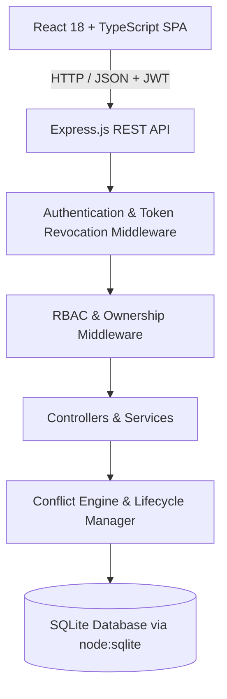

# Teacher–Student Appointment System

A full-stack, enterprise-grade academic appointment scheduling and consultation management platform designed for universities. Built with a modern React 18 / TypeScript frontend, a resilient Node.js / Express backend with native SQLite storage, and a comprehensive role-based access control (RBAC) architecture.

---

## Table of Contents

- [Overview](#overview)
- [System Capabilities & Roles](#system-capabilities--roles)
  - [Student Portal](#student-portal)
  - [Faculty / Teacher Portal](#faculty--teacher-portal)
  - [Administrative Control Center](#administrative-control-center)
- [Architecture & Tech Stack](#architecture--tech-stack)
- [Repository Structure](#repository-structure)
- [Prerequisites](#prerequisites)
- [Local Setup & Installation](#local-setup--installation)
- [Environment Configuration](#environment-configuration)
- [Running the Application](#running-the-application)
- [Verification & Testing](#verification--testing)
- [Deployment Configuration](#deployment-configuration)
- [Known Limitations & Roadmap](#known-limitations--roadmap)
- [Documentation Index](#documentation-index)

---

## Overview

The **Teacher–Student Appointment System** streamlines academic office hours, student advisement, and faculty consultations. It replaces unstructured email chains and ad-hoc scheduling with a centralized, conflict-free booking engine featuring immutable audit logging, interval overlap prevention, and multi-tier role authorization.

### Core Architectural Highlights
* **Zero Database Double-Booking**: Guaranteed at the storage layer via composite SQLite `UNIQUE` constraints and transaction-isolated conflict detection.
* **Native Runtime Performance**: Utilizes Node 22+ built-in `node:sqlite` driver, eliminating compilation friction and external database dependencies during local development.
* **Server-Side RBAC Enforcement**: Strict role-boundary middleware (`authorizeRoles`, `authorizeTeacherManagement`, `authorizeOwnerOrAdmin`) verifying cryptographic JWT claims and real-time token revocation.
* **Modular Design System**: Zero third-party CSS bloat; built upon a bespoke Vanilla CSS design system with CSS custom properties (design tokens), accessible focus rings, and dark/light themes.

---

## System Capabilities & Roles

The system models three primary user roles:

### Student Portal
* **Faculty Discovery**: Search verified professors by name, academic department (e.g., CSE, EEE, BBA), or courses taught.
* **Appointment Booking**: Request 1-on-1 consultations across published teacher availability slots with mandatory academic title and purpose declarations.
* **Lifecycle Management**: Track appointment statuses (`PENDING`, `APPROVED`, `REJECTED`, `CANCELLED`, `RESCHEDULE_PENDING`, `COMPLETED`).
* **Appointment Cancellation**: Cancel upcoming consultations with mandatory justification before terminal completion.
* **Notification Feed**: View system alerts and scheduling notifications.

### Faculty / Teacher Portal
* **Availability Slot Management**: Configure recurring or discrete office-hour slots with start/end ISO timestamps. Automated interval overlap detection prevents overlapping slot creation.
* **Consultation Request Reviews**: Review student booking requests, approve with guidance notes, or reject with explanatory feedback (which instantly reopens the time slot for other students).
* **Schedule Monitoring**: Daily/weekly view of upcoming confirmed consultations with student details and academic context.
* **Reschedule Workflows**: Propose alternative open availability slots for existing consultations.
* **Consultation Completion**: Formally mark concluded meetings as `COMPLETED`.

### Administrative Control Center
* **Appointment Monitor**: Comprehensive real-time view of all university consultations, filterable by date, department, teacher, student, and status.
* **Teacher Management**: Onboard faculty profiles, verify teacher credentials, update bios/office rooms, and suspend or activate teacher accounts.
* **User Accounts Ledger**: System-wide user directory with role assignment and account state controls (`ACTIVE`, `SUSPENDED`, `PENDING_APPROVAL`).
* **Immutable Audit Trail**: Append-only log recording actor identities, target entities, IP addresses, and state diffs for all administrative actions and status updates.
* **System Diagnostics & Health**: Real-time liveness, readiness, SQLite ping latency, schema migration synchronization, and Node.js process memory metrics.

---

## Architecture & Tech Stack



| Layer | Technology | Key Dependencies |
| :--- | :--- | :--- |
| **Frontend** | React 18, TypeScript, Vite | `react`, `react-dom`, `vite` |
| **Styling** | Vanilla CSS Design System | CSS variables, design tokens (`tokens.css`), responsive layouts |
| **Backend** | Node.js (CommonJS), Express | `express`, `jsonwebtoken`, `bcryptjs`, `cors`, `dotenv` |
| **Database** | SQLite 3 | Built-in `node:sqlite` (Node 22+) / `sqlite3` fallback |
| **Testing** | Node Native Test Runner & Supertest | `supertest`, `assert` |
| **Containerization** | Docker | Multi-stage build (`node:22-alpine`) |
| **Deployment** | Fly.io, Render | Persistent volume mounts on `/data` |

---

## Repository Structure

```text
├── .env.example             # Environment variable template
├── Dockerfile               # Multi-stage production container build
├── fly.toml                 # Fly.io deployment manifest (persistent volume)
├── render.yaml              # Render infrastructure-as-code specification
├── package.json             # Root scripts and workspace coordination
│
├── backend/                 # Node.js Express REST API
│   ├── src/
│   │   ├── config/          # Database connection, env loader, logger
│   │   ├── constants/       # Lifecycle enums, roles, HTTP status codes
│   │   ├── controllers/     # Request handlers (auth, admin, appointments, teachers)
│   │   ├── middlewares/     # Auth, RBAC, error handling, rate limiting, validation
│   │   ├── routes/          # Versioned REST routers (/api/v1/*)
│   │   ├── services/        # Business logic, conflict engine, tokens, passwords
│   │   ├── app.js           # Express application pipeline setup
│   │   └── server.js        # Server bootstrap and pre-flight checks
│   ├── tests/               # 12 backend test suites + admin view tests
│   └── README.md            # Backend developer documentation
│
├── database/                # Relational persistence and migrations
│   ├── migrations/          # Versioned SQL migration scripts (001, 002, 003)
│   ├── appointment_system.db# Active SQLite database file
│   ├── migrate.js           # Native Node.js migration runner
│   ├── migrate.ps1          # PowerShell migration runner
│   ├── schema.sql           # Consolidated reference schema
│   └── README.md            # Database catalog and schema documentation
│
├── docs/                    # Architectural and technical documentation
│   ├── ARCHITECTURE.md      # System design, data flow, component layout
│   ├── API.md               # Endpoints, request schemas, verified responses
│   ├── DATABASE.md          # Relational tables, constraints, indexes
│   ├── SECURITY.md          # Auth, JWT revocation, RBAC, defensive controls
│   ├── TESTING.md           # Test suite architecture, commands, results
│   ├── DEPLOYMENT.md        # Docker, Render, Fly.io configuration guide
│   ├── DESIGN.md            # Frontend design system and UI components
│   ├── PRD.md               # Product Requirements Document
│   ├── SRS.md               # Software Requirements Specification
│   ├── IMPLEMENTATION_PLAN.md# Prioritized audit recommendations
│   ├── DECISIONS.md         # Architecture Decision Records (ADRs)
│   └── CHANGELOG.md         # Milestone and version history
│
└── frontend/                # React 18 / TypeScript SPA
    ├── src/
    │   ├── components/      # Design system components (Button, Table, Badge, Dialog)
    │   ├── services/        # API integration clients (auth, student, teacher, admin)
    │   ├── styles/          # Design tokens, reset, global typography
    │   ├── types/           # TypeScript interfaces and contracts
    │   ├── views/           # Role-based views (Student, Teacher, Admin)
    │   └── App.tsx          # Root view orchestrator and session management
    ├── test-admin-integration.cjs # 14-point frontend API verification
    ├── vite.config.ts       # Vite build and proxy settings
    └── README.md            # Frontend developer guide
```

---

## Prerequisites

* **Node.js**: Version 22.0.0 or higher (Node 22 LTS or Node 24 recommended for native `node:sqlite`).
* **npm**: Version 10.0.0 or higher.
* **Operating System**: Windows, macOS, or Linux.
* **Docker** (optional): For containerized local execution.

---

## Local Setup & Installation

1. **Clone the Repository**:
   ```bash
   git clone <repository-url>
   cd "T-S appoinment system"
   ```

2. **Install Root & Backend Dependencies**:
   ```bash
   npm install
   ```

3. **Install Frontend Dependencies**:
   ```bash
   npm --prefix frontend install
   ```

4. **Initialize Environment Configuration**:
   ```bash
   cp .env.example .env
   ```

5. **Run Database Migrations**:
   ```bash
   npm run migrate
   ```
   *Verifies database connectivity and applies pending migrations (`001`, `002`, `003`).*

---

## Environment Configuration

Configure variables in `.env` (refer to `.env.example`):

| Variable | Default Value | Description |
| :--- | :--- | :--- |
| `NODE_ENV` | `development` | Environment mode (`development`, `production`, `test`) |
| `PORT` | `5000` | Port for the Express backend server |
| `API_PREFIX` | `/api/v1` | Root routing prefix for all REST endpoints |
| `DB_CLIENT` | `sqlite` | Database engine driver |
| `DB_FILE` | `database/appointment_system.db` | Relative or absolute path to SQLite database file |
| `JWT_SECRET` | *(Random string)* | Cryptographic secret for signing JWT access tokens (min 32 chars) |
| `ADMIN_INITIAL_EMAIL` | `admin@university.edu` | Email address for initial root administrator during production bootstrap |
| `ADMIN_INITIAL_PASSWORD` | *(None)* | Strong password for initial root administrator during production bootstrap (min 8 chars, uppercase, lowercase, digit, symbol; required in production) |
| `JWT_EXPIRES_IN` | `24h` | Token expiration duration (e.g. `24h`, `7d`) |
| `CLIENT_URL` | `http://localhost:3000` | Allowed origin for frontend client requests |
| `CORS_ORIGIN` | `http://localhost:3000` | CORS access-control origin policy |

---

## Running the Application

### Development Mode (Concurrent Frontend & Backend)

1. **Start Backend Service** (Port 5000):
   ```bash
   npm start
   # or natively on Windows:
   powershell -ExecutionPolicy Bypass -File backend/start_server.ps1
   ```

2. **Start Frontend Dev Server** (Port 3000):
   ```bash
   npm run frontend:dev
   ```

3. **Access the Application**:
   * Open browser at `http://localhost:3000`
   * Backend API catalog: `http://localhost:5000/api/v1/`
   * Health Probe: `http://localhost:5000/api/v1/health`
   * Readiness Probe: `http://localhost:5000/api/v1/ready`

### Seed Account Credentials (for Local Testing)

All seed accounts use the default password: `Password123!`

* **Administrator**: `admin@university.edu`
* **Faculty / Teacher**: `robert.miller@university.edu` (Dept: CSE)
* **Faculty / Teacher**: `sarah.jenkins@university.edu` (Dept: EEE)
* **Student**: `alice.carter@student.university.edu` (Dept: CSE, Batch: 2024)
* **Student**: `david.kim@student.university.edu` (Dept: BBA, Batch: 2023)

---

## Verification & Testing

The project contains automated verification covering security, business workflows, type safety, and production compilation:

```bash
# 1. Run all 12 backend integration test suites
npm test

# 2. Run Admin System Views tests (RBAC, Audit, System Status)
npm run test:admin-system

# 3. Run Frontend API Integration tests (Supertest + mock fetch)
npm run test:frontend-admin

# 4. Run TypeScript static type verification (0 errors expected)
npm run frontend:typecheck

# 5. Build production frontend distribution bundle
npm run frontend:build
```

---

## Deployment Configuration

The repository includes production infrastructure configurations for containerized platforms:

* **Docker**: Multi-stage build in [Dockerfile](file:///d:/T-S%20appoinment%20system/Dockerfile) compiling Vite assets into static files served by Express, running as a non-root `node` user with integrated `HEALTHCHECK`.
* **Fly.io**: Configured in [fly.toml](file:///d:/T-S%20appoinment%20system/fly.toml) with an attached persistent volume (`sqlite_data` mounted on `/data`) ensuring SQLite persistence across machine restarts.
* **Render**: Configured in [render.yaml](file:///d:/T-S%20appoinment%20system/render.yaml) targeting Docker runtime with health checks mapped to `/api/v1/health`.

For full deployment instructions, see [docs/DEPLOYMENT.md](file:///d:/T-S%20appoinment%20system/docs/DEPLOYMENT.md).

---

## Known Limitations & Architecture Notes

1. **Real-Time Notifications & SSE Lifecycle**: Implemented via `GET /api/v1/notifications/stream` with automated event dispatch across all appointment lifecycle state transitions (booking, confirmation, rejection, cancellation, rescheduling).
   * *Architecture Boundary*: The notification connection registry is in-memory and designed for single-process container environments. Multi-instance clustered deployments require an external message broker (e.g., Redis Pub/Sub).
2. **Notification Read State**: Implemented via `PATCH /api/v1/users/:id/notifications/:id/read` and `PATCH /api/v1/users/:id/notifications/read-all`, maintaining unread counters across client sessions.
3. **Student Consultation Feedback & Rating Engine**: Implemented via `POST /api/v1/appointments/:id/feedback` and `GET /api/v1/appointments/:id/feedback` with an integrated star rating and comments review dialog. Feedback is strictly immutable and eligible exclusively for concluded (`COMPLETED`) consultations.
4. **Interactive OpenAPI / Swagger Documentation**: Implemented via `swagger-ui-express` and served directly with route-scoped CSP isolation at `/docs` and `/api/v1/docs`, with raw JSON specifications available at `/api/v1/docs/openapi.json` and `/api-docs.json`.
5. **Horizontal Multi-Instance Scaling**: The native SQLite storage engine and in-memory rate limiter are optimized for unified single-instance container deployments (Fly.io with persistent volume mounts, Render with Docker). Multi-instance clustered deployments require migrating to PostgreSQL and Redis.
6. **Deployment Verification Status**: Step 2 completed end-to-end local production-mode verification against the compiled distribution bundle. External hosting deployment (e.g. Render / Fly.io) requires provisioning cloud credentials and setting production secrets.

---

## Documentation Index

Detailed engineering references are available in the `docs/` directory:

* **[docs/PRD.md](file:///d:/T-S%20appoinment%20system/docs/PRD.md)** — Product Requirements Document.
* **[docs/SRS.md](file:///d:/T-S%20appoinment%20system/docs/SRS.md)** — Software Requirements Specification.
* **[docs/ARCHITECTURE.md](file:///d:/T-S%20appoinment%20system/docs/ARCHITECTURE.md)** — Comprehensive architectural blueprint.
* **[docs/DESIGN.md](file:///d:/T-S%20appoinment%20system/docs/DESIGN.md)** — Frontend design system and UI specifications.
* **[docs/DATABASE.md](file:///d:/T-S%20appoinment%20system/docs/DATABASE.md)** — Database schema catalog and constraints.
* **[docs/API.md](file:///d:/T-S%20appoinment%20system/docs/API.md)** — REST API reference and payload contracts.
* **[docs/SECURITY.md](file:///d:/T-S%20appoinment%20system/docs/SECURITY.md)** — Threat modeling, auth, and defensive review.
* **[docs/TESTING.md](file:///d:/T-S%20appoinment%20system/docs/TESTING.md)** — Test architecture, verified results, and coverage notes.
* **[docs/DEPLOYMENT.md](file:///d:/T-S%20appoinment%20system/docs/DEPLOYMENT.md)** — Production hosting and containerization guide.
* **[docs/IMPLEMENTATION_PLAN.md](file:///d:/T-S%20appoinment%20system/docs/IMPLEMENTATION_PLAN.md)** — Prioritized feature roadmap.
* **[docs/DECISIONS.md](file:///d:/T-S%20appoinment%20system/docs/DECISIONS.md)** — Architectural Decision Records (ADRs).
* **[docs/CHANGELOG.md](file:///d:/T-S%20appoinment%20system/docs/CHANGELOG.md)** — Version release notes and milestones.
* **[frontend/README.md](file:///d:/T-S%20appoinment%20system/frontend/README.md)** — Frontend developer and component guide.
* **[backend/README.md](file:///d:/T-S%20appoinment%20system/backend/README.md)** — Backend foundation and routing guide.
