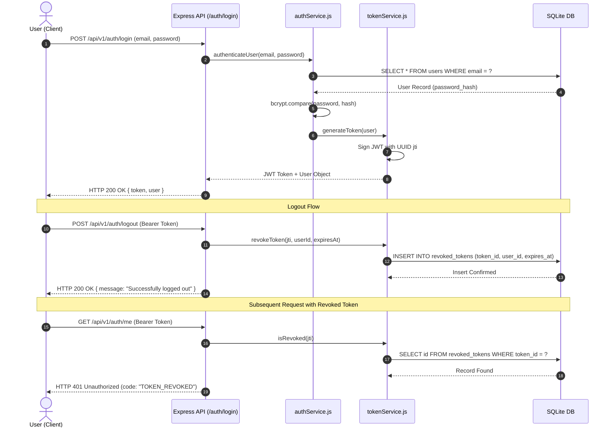
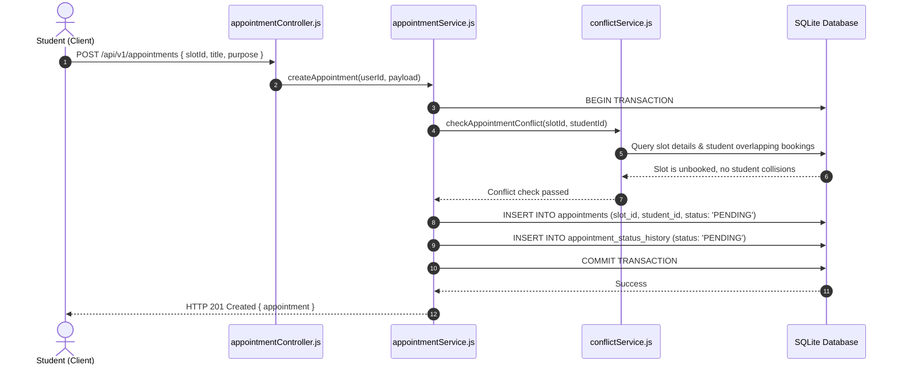

# System Architecture & Technical Blueprint

## Project: Teacher–Student Appointment System
* **Document Version:** 1.0.0
* **Date:** October 2026

---

## 1. High-Level System Topology

The system implements a classic 3-tier decoupled architecture:
1. **Client Tier**: React 18 Single Page Application (SPA) with TypeScript, bundled by Vite and styled with a custom Vanilla CSS design token system.
2. **Application Tier**: Node.js HTTP server running Express, structured into versioned controllers, domain services, security middlewares, and validation schemas.
3. **Data Tier**: SQLite 3 relational database managed through the Node 22+ native `node:sqlite` driver, operating with write-ahead logging (WAL), foreign key enforcement, and ACID transactions.

```mermaid
graph TB
    subgraph Client Tier ["Client Tier (Browser)"]
        SPA["React 18 / TypeScript SPA"]
        ApiClient["apiClient.ts (Fetch + JWT Interceptor)"]
        DesignSystem["Design System (tokens.css + Components)"]
        SPA --> ApiClient
        SPA --> DesignSystem
    end

    subgraph AppTier ["Application Tier (Node.js / Express)"]
        Router["Root Router (/api/v1)"]
        AuthMW["Authentication Middleware (JWT + JTI Revocation)"]
        RBACMW["RBAC Middleware (authorizeRoles / authorizeOwner)"]
        ValMW["Schema Validator Middleware"]
        Controllers["Express Controllers (Admin, Appt, Teacher, Auth)"]
        Services["Domain Services (Appointment, Conflict, Token)"]

        Router --> AuthMW
        AuthMW --> RBACMW
        RBACMW --> ValMW
        ValMW --> Controllers
        Controllers --> Services
    end

    subgraph DataTier ["Data Tier (Persistence)"]
        DBManager["database.js (Connection & Transaction Manager)"]
        SQLiteEngine["node:sqlite Engine (WAL Mode, FK Enabled)"]
        DBFile[("appointment_system.db")]

        Services --> DBManager
        DBManager --> SQLiteEngine
        SQLiteEngine --> DBFile
    end

    ApiClient -->|HTTP / JSON (Bearer Token)| Router
```

---

## 2. Component Responsibilities

### 2.1 Client Tier (Frontend)
* **View Layer (`frontend/src/views/`)**: Organized by role boundaries (`student/`, `teacher/`, `admin/`). Views manage local filter states, pagination, and data retrieval.
* **Component Library (`frontend/src/components/`)**: Atomic and composite UI components (`Button`, `Table`, `Badge`, `Alert`, `Dialog`, `Form`, `Feedback`, `Navigation`).
* **Service Layer (`frontend/src/services/`)**: Typed API clients (`authService`, `studentService`, `teacherService`, `adminService`) wrapping `apiClient.ts`.
* **Design System Tokens (`frontend/src/styles/tokens.css`)**: Curated CSS variables establishing primary indigo palettes, typography scales, neutral surfaces, focus outlines, and border radiuses.

### 2.2 Middleware Pipeline (`backend/src/middlewares/`)
1. **`requestLogger.js`**: Intercepts all incoming requests, tracks response durations, logs HTTP methods and status codes, and sanitizes sensitive fields (`password`, `token`).
2. **`rateLimiter.js`**: In-memory sliding-window rate limiter protecting sensitive endpoints (e.g. `/api/v1/auth/login`).
3. **`authMiddleware.js`**: Parses `Authorization: Bearer <token>`, verifies signature using `JWT_SECRET`, and queries `revoked_tokens` to reject invalidated sessions.
4. **`rbacMiddleware.js`**: Enforces role access policies:
   * `authorizeRoles(allowedRoles)`: Rejects callers without required role.
   * `authorizeTeacherManagement()`: Ensures faculty can only modify their own profile and slots.
   * `authorizeOwnerOrAdmin()`: Restricts private student/user data to owner or admin.
5. **`validator.js`**: Validates request parameters and bodies against structured declarative schemas.
6. **`errorHandler.js`**: Centralized catch-all handler translating domain errors into standardized JSON payloads:
   ```json
   {
     "success": false,
     "error": {
       "code": "SLOT_OVERLAP",
       "message": "The proposed time slot overlaps with an existing slot."
     }
   }
   ```

### 2.3 Domain Services (`backend/src/services/`)
* **`authService.js`**: User credential verification with timing-attack mitigation and session creation.
* **`tokenService.js`**: Cryptographic token signing, decoding, and database-backed revocation management.
* **`conflictService.js`**: Algorithmic evaluation of schedule collisions, overlapping slots, and double-booking attempts.
* **`appointmentService.js`**: State machine transitions (`create`, `approve`, `reject`, `reschedule`, `cancel`, `complete`) wrapped in atomic transactions.
* **`adminTeacherService.js`**: Administrative teacher verification and profile updates.
* **`adminAppointmentService.js`**: Aggregated appointment metrics and system-wide monitoring queries.
* **`adminBootstrapService.js`**: One-time root administrator credential provisioning, complexity enforcement, and fail-closed production startup verification (BLK-01 remediation).
* **`migrationService.js`**: Inspects executed vs available migration files to power the `/api/v1/ready` diagnostic probe.

### 2.4 Data Tier (`backend/src/config/database.js`)
* Manages the SQLite database connection using native Node.js 22 `node:sqlite`.
* Executes `PRAGMA foreign_keys = ON;` and `PRAGMA journal_mode = WAL;` on startup.
* Provides unified helper methods: `query(sql, params)`, `queryOne(sql, params)`, `execute(sql, params)`, and `transaction(fn)`.

---

## 3. Core Data Flows

### 3.1 Authentication & Token Revocation Flow



### 3.2 Appointment Booking & Conflict Protection Flow



---

## 4. Key Architectural Decisions (ADR Summary)

| Decision | Selected Option | Alternatives Considered | Rationale |
| :--- | :--- | :--- | :--- |
| **Database Engine** | **SQLite 3 (`node:sqlite`)** | PostgreSQL, MySQL, MongoDB | Zero external setup friction, single-file portability, sub-millisecond query execution, native Node 22 engine without external C++ compilation bindings. |
| **Frontend Styling** | **Vanilla CSS + Design Tokens** | TailwindCSS, CSS-in-JS, Material UI | Maximum architectural control, zero CSS utility runtime, native CSS custom property theming, lightweight bundle size. |
| **Token Invalidation** | **Server-side JTI Revocation Store** | Stateless JWT (wait for expiry), Redis blacklist | Ensures immediate logout security without introducing Redis dependency into local deployment. |
| **Transaction Boundary** | **Service-Level Explicit Transactions** | Controller-level transactions, Autocommit | Keeps database transaction lifecycles isolated to core mutation logic within domain services. |

---

## 5. Scalability & Deployment Boundaries

* **Current Architecture**: Optimized as a unified, monolithic container running on a single instance with local persistent storage (e.g. Fly.io persistent volume mounted at `/data`).
* **Multi-Instance Clustering Requirements**:
  * To run multiple stateless backend replicas behind a load balancer, SQLite must be migrated to a networked relational database (e.g., PostgreSQL).
  * In-memory token revocation and rate-limiting stores must be transitioned to a shared cache (e.g., Redis).
