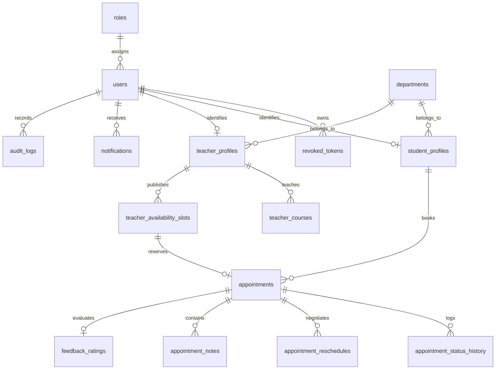

# Database Schema Catalog & Persistence Blueprint

## Project: Teacher–Student Appointment System
* **Document Version:** 1.0.0
* **Date:** October 2026
* **Database Engine:** SQLite 3 (Node.js 22+ native `node:sqlite`)
* **Default Database File:** `database/appointment_system.db`

---

## 1. Relational Schema Catalog (17 Entities)

The database schema is organized into 16 relational entities enforcing strict referential integrity, check constraints, and unique indices:



### Table Definitions & Constraints

| Table Name | Description | Key Columns & Constraints | Foreign Keys |
| :--- | :--- | :--- | :--- |
| **`schema_migrations`** | Version ledger for executed migrations. | `id` (PK), `version` (VARCHAR, UNIQUE), `name` (VARCHAR), `applied_at` (TIMESTAMP) | None |
| **`roles`** | Core system role definitions (`STUDENT`, `TEACHER`, `ADMIN`). | `id` (PK), `name` (VARCHAR, UNIQUE, CHECK IN ('STUDENT', 'TEACHER', 'ADMIN')) | None |
| **`departments`** | University academic departments. | `id` (PK), `code` (VARCHAR, UNIQUE), `name` (VARCHAR) | None |
| **`users`** | Central authentication accounts and state. | `id` (PK), `role_id` (INT), `email` (VARCHAR, UNIQUE), `password_hash` (VARCHAR), `first_name` (VARCHAR), `last_name` (VARCHAR), `status` (CHECK IN ('ACTIVE', 'PENDING_APPROVAL', 'SUSPENDED')) | `role_id` -> `roles(id)` |
| **`student_profiles`** | Academic profiles for enrolled students. | `id` (PK), `user_id` (INT, UNIQUE), `student_id_number` (VARCHAR, UNIQUE), `department_id` (INT), `batch` (VARCHAR) | `user_id` -> `users(id)` ON DELETE CASCADE,<br>`department_id` -> `departments(id)` |
| **`teacher_profiles`** | Academic profiles for faculty members. | `id` (PK), `user_id` (INT, UNIQUE), `department_id` (INT), `designation` (VARCHAR), `office_room` (VARCHAR), `bio` (TEXT), `is_verified` (BOOLEAN DEFAULT 0) | `user_id` -> `users(id)` ON DELETE CASCADE,<br>`department_id` -> `departments(id)` |
| **`teacher_courses`** | Course affiliations for faceted faculty search. | `id` (PK), `teacher_id` (INT), `course_code` (VARCHAR), `course_name` (VARCHAR), UNIQUE(`teacher_id`, `course_code`) | `teacher_id` -> `teacher_profiles(id)` ON DELETE CASCADE |
| **`teacher_availability_slots`** | Published office-hour availability windows. | `id` (PK), `teacher_id` (INT), `start_timestamp` (TIMESTAMP), `end_timestamp` (TIMESTAMP), `is_available` (BOOLEAN DEFAULT 1), `is_active` (BOOLEAN DEFAULT 1), UNIQUE(`teacher_id`, `start_timestamp`), CHECK(`start_timestamp` < `end_timestamp`) | `teacher_id` -> `teacher_profiles(id)` ON DELETE CASCADE |
| **`appointments`** | Confirmed and requested consultation sessions. | `id` (PK), `slot_id` (INT, UNIQUE), `student_id` (INT), `title` (VARCHAR), `purpose` (TEXT), `status` (CHECK IN ('PENDING', 'APPROVED', 'REJECTED', 'CANCELLED', 'RESCHEDULE_PENDING', 'COMPLETED')) | `slot_id` -> `teacher_availability_slots(id)`,<br>`student_id` -> `student_profiles(id)` |
| **`appointment_status_history`** | Chronological audit trail of appointment transitions. | `id` (PK), `appointment_id` (INT), `previous_status` (VARCHAR), `new_status` (VARCHAR), `changed_by` (INT), `notes` (TEXT), `created_at` (TIMESTAMP) | `appointment_id` -> `appointments(id)` ON DELETE CASCADE,<br>`changed_by` -> `users(id)` |
| **`appointment_reschedules`** | Reschedule negotiation records. | `id` (PK), `appointment_id` (INT), `previous_slot_id` (INT), `proposed_slot_id` (INT), `requested_by` (INT), `reason` (TEXT), `status` (CHECK IN ('PENDING', 'ACCEPTED', 'DECLINED')) | `appointment_id` -> `appointments(id)` ON DELETE CASCADE,<br>`previous_slot_id` -> `teacher_availability_slots(id)`,<br>`proposed_slot_id` -> `teacher_availability_slots(id)` |
| **`appointment_notes`** | Meeting notes and student guidance. | `id` (PK), `appointment_id` (INT), `author_id` (INT), `notes` (TEXT) | `appointment_id` -> `appointments(id)` ON DELETE CASCADE,<br>`author_id` -> `users(id)` |
| **`feedback_ratings`** | Student ratings and qualitative reviews. | `id` (PK), `appointment_id` (INT, UNIQUE), `student_id` (INT), `rating` (INT, CHECK BETWEEN 1 AND 5), `comments` (TEXT) | `appointment_id` -> `appointments(id)` ON DELETE CASCADE,<br>`student_id` -> `student_profiles(id)` |
| **`notifications`** | User alerts and reminder notifications. | `id` (PK), `user_id` (INT), `appointment_id` (INT NULL), `title` (VARCHAR), `message` (TEXT), `type` (CHECK IN ('BOOKING_REQUEST', 'APPROVAL', 'REJECTION', 'CANCELLATION', 'RESCHEDULE', 'REMINDER', 'SYSTEM')), `is_read` (BOOLEAN DEFAULT 0) | `user_id` -> `users(id)` ON DELETE CASCADE,<br>`appointment_id` -> `appointments(id)` ON DELETE SET NULL |
| **`audit_logs`** | Administrative immutable audit ledger. | `id` (PK), `actor_id` (INT), `action` (VARCHAR), `entity_type` (VARCHAR), `entity_id` (VARCHAR), `details` (TEXT), `ip_address` (VARCHAR), `created_at` (TIMESTAMP) | `actor_id` -> `users(id)` |
| **`revoked_tokens`** | Blacklisted JWT IDs (`jti`) for invalidated sessions. | `id` (PK), `token_id` (VARCHAR, UNIQUE), `user_id` (INT), `expires_at` (TIMESTAMP), `revoked_at` (TIMESTAMP) | `user_id` -> `users(id)` ON DELETE CASCADE |
| **`admin_bootstrap_state`** | Immutable audit log of one-time administrative credential provisioning. | `id` (PK), `admin_id` (INT), `bootstrapped_at` (TIMESTAMP), `bootstrapped_by` (VARCHAR), `ip_address` (VARCHAR) | `admin_id` -> `users(id)` ON DELETE CASCADE |

---

## 2. Integrity Guarantees & Concurrency Controls

### 2.1 Double-Booking Elimination
Double-booking is prevented by database-level constraints rather than vulnerable application-level checks alone:
```sql
CREATE TABLE appointments (
    id INTEGER PRIMARY KEY AUTOINCREMENT,
    slot_id INTEGER NOT NULL UNIQUE, -- STRICT UNCONDITIONAL UNIQUENESS
    ...
);
```
Even under concurrent HTTP requests arriving at the identical millisecond, SQLite's transactional lock guarantees only one `INSERT` succeeds. The second attempt violates the `UNIQUE(slot_id)` constraint and fails with a deterministic SQL error handled as an HTTP `409 Conflict`.

### 2.2 Interval Overlap Protection
```sql
CREATE TABLE teacher_availability_slots (
    ...
    UNIQUE(teacher_id, start_timestamp),
    CHECK(start_timestamp < end_timestamp)
);
```
Composite uniqueness guarantees that no faculty member can create multiple availability slots sharing the exact same start time. Interval overlap across broader ranges is enforced transactionally by `slotService.js` and `conflictService.js`.

---

## 3. Migration Ledger & History

Database migrations are tracked in `schema_migrations` and executed sequentially:

1. **`001_initial_schema.sql`**:
   * Initializes tables 1–15, primary foreign keys, and status check constraints.
   * Creates performance indexes on `appointments(student_id)`, `teacher_availability_slots(teacher_id, start_timestamp)`, and `audit_logs(actor_id, created_at)`.
2. **`002_seed_initial_data.sql`**:
   * Seeds default roles (`STUDENT`, `TEACHER`, `ADMIN`) and academic departments (`CSE`, `EEE`, `BBA`, `MATH`, `PHY`, `ENG`).
   * Seeds verified faculty profiles, course catalogs, student accounts, and future availability slots.
3. **`003_auth_and_session_tokens.sql`**:
   * Creates `revoked_tokens` table for session invalidation.
   * Updates mock seed password hashes to valid `bcrypt` hashes (`Password123!`) enabling local authentication testing.
4. **`004_secure_admin_bootstrap.sql`**:
   * Creates `admin_bootstrap_state` ledger tracking one-time administrative provisioning.
   * Neutralizes hardcoded default test administrator passwords (`Password123!`) in fresh and production databases by updating `users.password_hash` to an unmatchable disabled token. Ensures default administrator credentials can never authenticate in production.

---

## 4. Persistence in Production & Containers

* **Local Environment**: Persisted at `database/appointment_system.db`.
* **Container Runtime (Docker)**: The `Dockerfile` establishes a dedicated directory `/data` owned by the non-root `node` user.
* **Fly.io Volume Mount**: Configured in `fly.toml`:
  ```toml
  [mounts]
    source = "sqlite_data"
    destination = "/data"
  ```
  The database file is mapped to `/data/appointment_system.db`, ensuring that data persists across VM reboots, deploys, and restarts.
