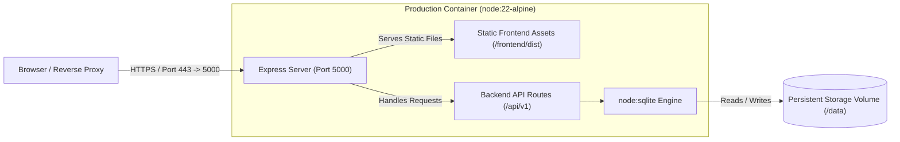

# Deployment, Operations & Containerization Guide

## Project: Teacher–Student Appointment System
* **Document Version:** 1.0.0
* **Date:** October 2026

---

## 1. Deployment Overview

The application is architected to run as a unified, self-contained container serving both the compiled React frontend static assets and the Node.js Express REST API, backed by persistent SQLite storage.



---

## 2. Environment Variables Reference

| Variable | Required | Default in Local | Production Recommendation | Description |
| :--- | :--- | :--- | :--- | :--- |
| `NODE_ENV` | Yes | `development` | `production` | Enables production optimizations and disables stack traces. |
| `PORT` | Yes | `5000` | `5000` | Web server listening port. |
| `API_PREFIX` | No | `/api/v1` | `/api/v1` | Routing prefix for all REST controllers. |
| `DB_CLIENT` | Yes | `sqlite` | `sqlite` | Database connector type (`sqlite`). |
| `DB_FILE` | Yes | `database/appointment_system.db` | `/data/appointment_system.db` | Path to persistent SQLite database file. |
| `JWT_SECRET` | Yes | *(Dev secret)* | *(Generated Secret)* | Minimum 32-character high-entropy secret for HMAC-SHA256 signing. |
| `JWT_EXPIRES_IN` | No | `24h` | `24h` | Token expiration duration (e.g. `24h`, `7d`). |
| `CLIENT_URL` | No | `http://localhost:3000` | `https://your-domain.com` | Allowed client URL for CORS origin checking. |
| `LOG_LEVEL` | No | `info` | `info` | Logging verbosity (`debug`, `info`, `warn`, `error`). |

---

## 3. Docker Containerization

The project includes an optimized multi-stage [Dockerfile](file:///d:/T-S%20appoinment%20system/Dockerfile) based on `node:22-alpine`:

### 3.1 Multi-Stage Build Architecture
1. **Stage 1 (`builder`)**:
   * Installs dev dependencies.
   * Copies `frontend/` source code.
   * Executes `npm --prefix frontend run build` to compile the Vite bundle into `/build/frontend/dist`.
2. **Stage 2 (`runner`)**:
   * Copies production dependencies (`npm install --omit=dev`).
   * Copies `backend/`, `database/`, and compiled `frontend/dist/`.
   * Establishes `/data` directory with ownership granted to non-root `node:node`.
   * Configures native `HEALTHCHECK` probing `GET /api/v1/health`.
   * Runs migrations on startup before starting Express:
     ```bash
     CMD ["sh", "-c", "node database/migrate.js && node backend/src/server.js"]
     ```

### 3.2 Docker Build & Run Commands

```bash
# 1. Build production image
docker build -t ts-appointment-system .

# 2. Create persistent volume for SQLite
docker volume create appointment_data

# 3. Run container attached to volume
docker run -d \
  --name appointment_app \
  -p 5000:5000 \
  -e NODE_ENV=production \
  -e JWT_SECRET="your_secure_random_production_secret_key_here" \
  -e DB_FILE="/data/appointment_system.db" \
  -v appointment_data:/data \
  --restart unless-stopped \
  ts-appointment-system

# 4. Verify container logs & health
docker logs appointment_app
docker inspect --format='{{json .State.Health}}' appointment_app
```

---

## 4. Cloud Platform Deployments

### 4.1 Deployment on Fly.io

The repository includes a ready-to-deploy [fly.toml](file:///d:/T-S%20appoinment%20system/fly.toml) configuration with dedicated volume mounts:

```bash
# 1. Authenticate with Fly CLI
fly auth login

# 2. Launch application (use existing fly.toml)
fly launch --no-deploy

# 3. Create persistent storage volume in your primary region (e.g. iad)
fly volumes create sqlite_data --size 1 --region iad

# 4. Set production secrets
fly secrets set JWT_SECRET="your_cryptographically_secure_random_key"

# 5. Deploy application
fly deploy
```

#### Fly.io Manifest Analysis (`fly.toml`)
* Mounts persistent volume `sqlite_data` to `/data`.
* Configures single-machine execution (`min_machines_running = 1`, `auto_stop_machines = "stop"`) to prevent split-brain SQLite writes.
* Configures automated HTTP health checks on `/api/v1/health` with a 30s interval.

### 4.2 Deployment on Render

Configured via [render.yaml](file:///d:/T-S%20appoinment%20system/render.yaml):
* Service type: `web`
* Runtime: `docker`
* Health Check Path: `/api/v1/health`
* Generates `JWT_SECRET` automatically on creation.

> [!IMPORTANT]
> **Database Persistence on Render**: Render free web services utilize ephemeral filesystems that reset on redeployment. For persistent SQLite storage on Render, a paid plan with a persistent disk attached at `/data` is required. For free-tier SQLite hosting, Fly.io's persistent volume is recommended.

---

## 5. Database Persistence & Backup Guidelines

When running SQLite in production under Write-Ahead Logging (`WAL` mode):
1. The database produces three active files:
   * `appointment_system.db` (main relational store)
   * `appointment_system.db-wal` (write-ahead log)
   * `appointment_system.db-shm` (shared memory index)
2. **Safe Backup Procedure**: Do not directly copy `appointment_system.db` while transactions are active. Use SQLite's safe online backup API or CLI:
   ```bash
   # Online backup snapshot
   sqlite3 /data/appointment_system.db ".backup '/data/backup-$(date +%Y%m%d).db'"
   ```

---

## 6. Operational Troubleshooting & Health Diagnostics

| Symptom | Diagnostic Step | Resolution |
| :--- | :--- | :--- |
| **Container restarts continuously** | Check `docker logs` for migration or port errors. | Ensure `/data` directory is writable by `node` user (`chown -R node:node /data`). |
| **`SQLITE_BUSY: database is locked`** | Check for long-running uncommitted transactions or multiple container replicas accessing the same file. | Ensure container is running as a single instance (`min_machines_running = 1`). SQLite does not support multi-writer network clustering. |
| **Readiness probe returns 503 (`/api/v1/ready`)** | Inspect `checks.migrations.pendingCount` in response payload. | Run `node database/migrate.js` to apply pending migrations. |
| **Frontend displays network error connecting to `/api/v1`** | Verify backend is bound to `0.0.0.0` inside container, not `127.0.0.1`. | Confirm `server.js` listens on `process.env.PORT || 5000`. In dev mode, verify Vite proxy in `vite.config.ts`. |
