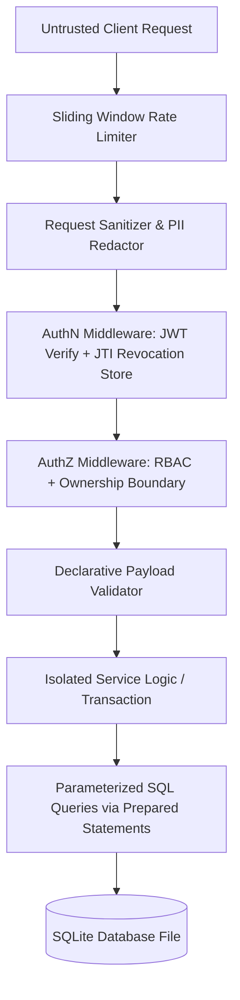

# Security Architecture & Defensive Review

## Project: Teacher–Student Appointment System
* **Document Version:** 1.0.0
* **Date:** October 2026

---

## 1. Security Architecture & Threat Model

The application implements a multi-layered defense-in-depth model protecting academic records, faculty calendars, and administrative controls:



---

## 2. Authentication & Credential Management

### 2.1 Password Security & Hashing
* **Algorithm**: `bcrypt` (via `bcryptjs`).
* **Work Factor**: 10 salt rounds (`$2b$10$...`).
* **Storage**: Passwords are never stored in plaintext. Seed and user records store exclusively the one-way bcrypt digest in `users.password_hash`.

### 2.2 Timing Attack Mitigation
In standard authentication workflows, an early return when an email is not found creates a measurable timing discrepancy (user enumeration vulnerability). In [backend/src/services/authService.js](file:///d:/T-S%20appoinment%20system/backend/src/services/authService.js):
```javascript
if (!user || user.status !== 'ACTIVE') {
  // Execute dummy hash comparison to prevent timing enumeration
  await bcrypt.compare(password, DUMMY_HASH);
  throw new AppError('Invalid email or password.', HTTP_STATUS.UNAUTHORIZED, 'INVALID_CREDENTIALS');
}
```
Regardless of whether an email exists or is inactive, execution time remains uniform.

### 2.3 JWT Lifecycle & Cryptographic Revocation
* **Algorithm**: HMAC-SHA256 (`HS256`).
* **Token Expiration**: Configurable via `JWT_EXPIRES_IN` (default: `24h`).
* **Revocation Engine (`revoked_tokens`)**:
  * Every issued JWT includes a unique UUID v4 identifier (`jti`).
  * When a user logs out (`POST /api/v1/auth/logout`), the token's `jti`, `userId`, and `expires_at` are persisted into the `revoked_tokens` table.
  * The `authMiddleware.js` pipeline verifies that `tokenService.isRevoked(jti)` returns false on every subsequent request.
  * If a revoked token is presented, the request is immediately rejected with HTTP `401 Unauthorized` (`code: 'TOKEN_REVOKED'`).

### 2.4 Administrator Credential Provisioning & One-Time Bootstrap (BLK-01 Remediation)
* **Default Credential Elimination**: Migration `004_secure_admin_bootstrap.sql` neutralizes hardcoded default test passwords (`Password123!`) on fresh database initialization by replacing the digest with an unmatchable disabled token (`$2b$10$DISABLED_PENDING_BOOTSTRAP...`).
* **Operator-Driven Provisioning**: The initial root administrator is provisioned exclusively before the HTTP server binds to public traffic via environment secrets:
  * `ADMIN_INITIAL_PASSWORD`: Required in production; validated for complexity (min 8 chars, uppercase, lowercase, number, symbol; weak/dictionary values rejected).
  * `ADMIN_INITIAL_EMAIL`: Optional; defaults to institutional admin address.
  * `ADMIN_INITIAL_FIRST_NAME` / `ADMIN_INITIAL_LAST_NAME`: Optional identity fields.
* **One-Time Behavior**: Bootstrap is strictly atomic and one-time. Successful provisioning is recorded in `admin_bootstrap_state`. Subsequent restarts or repeated bootstrap attempts are rejected and ignore the environment variable without modifying the administrator.
* **Fail-Closed Production Startup**: In production (`NODE_ENV=production`), the backend server (`server.js`) verifies that an administrator has been legitimately provisioned before invoking `app.listen()`. If no administrator is provisioned and `ADMIN_INITIAL_PASSWORD` is absent, the server halts immediately with fatal exit code 1.
* **Zero Public Surface**: No public or unauthenticated HTTP bootstrap endpoints exist. Provisioning runs strictly in-process during container initialization or via offline CLI (`node backend/src/bin/bootstrapAdmin.js`).

---

## 3. Authorization & Role-Based Access Control (RBAC)

Authorization is strictly enforced **server-side** at the route level in [backend/src/middlewares/rbacMiddleware.js](file:///d:/T-S%20appoinment%20system/backend/src/middlewares/rbacMiddleware.js):

### 3.1 Policy Boundaries

| Policy Guard | Implementation | Enforcement Target |
| :--- | :--- | :--- |
| **`authorizeRoles('ADMIN')`** | Verifies `req.user.role === 'ADMIN'` | Guarding `/api/v1/admin/*` (users, audit logs, global appointment monitor). Students and Teachers receive `403 Forbidden`. |
| **`authorizeTeacherManagement()`** | Admins bypass; Teachers can only manage their own ID; Students blocked entirely. | Guarding `/api/v1/teachers/:id/*` (slot creation, updates, deletions). |
| **`authorizeOwnerOrAdmin('id')`** | Verifies `req.user.id === targetId` or `req.user.role === 'ADMIN'`. | Guarding `/api/v1/users/:id/*` (notifications, profiles). |

### 3.2 Defensive Verification Evidence
Automated security tests in `backend/tests/securityDefensiveReview.test.js` and `backend/tests/adminSystemViews.test.js` verify:
* Student JWT attempting `GET /api/v1/admin/users` -> **403 Forbidden**
* Teacher JWT attempting `GET /api/v1/admin/audit-logs` -> **403 Forbidden**
* Teacher A attempting `PATCH /api/v1/teachers/2` (Teacher B) -> **403 Forbidden**
* Student attempting to access another student's notifications -> **403 Forbidden**

---

## 4. Input Sanitization & Injection Defense

### 4.1 SQL Injection Elimination
The application utilizes parameterized prepared statements for 100% of its database interactions via `db.query(sql, params)`, `db.queryOne(sql, params)`, and `db.execute(sql, params)`:
```javascript
// Parameterized SQL Example
await db.queryOne('SELECT id, email, status FROM users WHERE id = ?;', [userId]);
```
No user input is ever concatenated into raw SQL strings.

### 4.2 Logging Sanitization & PII Redaction
In [backend/src/config/logger.js](file:///d:/T-S%20appoinment%20system/backend/src/config/logger.js) and [backend/src/middlewares/requestLogger.js](file:///d:/T-S%20appoinment%20system/backend/src/middlewares/requestLogger.js):
* Sensitive request fields (`password`, `confirmPassword`, `token`, `secret`, `authorization`, `cookie`) are redacted with `"[REDACTED]"` prior to standard output emission.
* Prevents leakage of credentials in container log aggregators or terminal recordings.

---

## 5. Denial-of-Service & Rate Limiting

* **Brute-Force Protection**: An in-memory sliding-window rate limiter is mounted on `POST /api/v1/auth/login`.
* **Threshold**: 10 requests per minute per IP address.
* **Exceeded Behavior**: Returns HTTP `429 Too Many Requests` (`code: 'RATE_LIMIT_EXCEEDED'`) with `Retry-After` header.

---

## 6. Container Security & Runtime Hardening

* **Non-Root Execution**: The production [Dockerfile](file:///d:/T-S%20appoinment%20system/Dockerfile) sets `USER node`, ensuring that application processes do not run with root UID/GID.
* **Minimal Attack Surface**: Uses `node:22-alpine` as base image.
* **Health Probing**: Native Docker `HEALTHCHECK` periodically verifies `/api/v1/health` without executing shell utilities.

---

## 7. Known Security Limitations & Production Recommendations

1. **In-Memory Rate Limiting**: The current rate limiter tracks counters in Node.js process memory. In a clustered multi-instance deployment, rate limiting state should be backed by a centralized Redis instance.
2. **Secrets Rotation**: Ensure `JWT_SECRET` is generated using high-entropy random bytes (`openssl rand -base64 32`) and passed via environment secret managers rather than committed files.
3. **HTTPS / TLS Termination**: In production, HTTPS must be terminated at the reverse proxy or cloud ingress (e.g. Fly.io `force_https = true` as specified in `fly.toml`).
