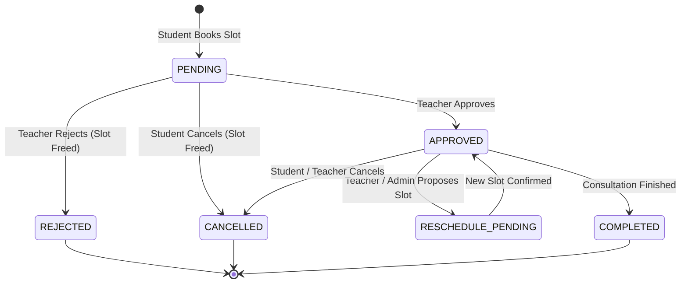

# Software Requirements Specification (SRS)

## Project: Teacher–Student Appointment System
* **Document Version:** 1.0.0
* **Date:** October 2026
* **Standard:** IEEE 830-1998 Aligned

---

## 1. Introduction

### 1.1 Purpose
This document provides a formal, comprehensive specification of the functional, performance, security, and operational requirements for the university **Teacher–Student Appointment System**. It serves as the single source of truth for software engineers, quality assurance testers, and academic administrators.

### 1.2 Scope
The software product is a multi-tier web application comprising:
* A responsive Single Page Application (SPA) frontend built with React 18 and TypeScript.
* A RESTful API backend built with Node.js and Express.
* A relational persistence engine utilizing native SQLite 3 (`node:sqlite`).
* Supporting containerization and deployment configurations for Docker, Fly.io, and Render.

### 1.3 Definitions, Acronyms, and Abbreviations
* **RBAC**: Role-Based Access Control.
* **JWT**: JSON Web Token (RFC 7519).
* **JTI**: JWT ID, a unique identifier assigned to individual JWT instances for revocation tracking.
* **UTC**: Coordinated Universal Time (ISO 8601 representation: `YYYY-MM-DDTHH:MM:SSZ`).
* **Terminal State**: An appointment lifecycle status (`COMPLETED` or `CANCELLED`) from which no further status mutations are permitted.

---

## 2. Overall Description

### 2.1 Product Perspective
The system functions as a self-contained academic consultation portal deployed in containerized environments. It does not depend on external SaaS authentication or third-party database servers for standard operation, utilizing local SQLite persistence on mounted persistent storage.

### 2.2 User Classes and Roles
1. **Student (`STUDENT`)**: Enrolled university student seeking academic consultation.
2. **Teacher (`TEACHER`)**: Academic faculty member holding consultation office hours.
3. **Administrator (`ADMIN`)**: Department head or system administrator with global operational authority.

### 2.3 Operating Environment
* **Server Runtime**: Node.js v22.0.0+ (requires `node:sqlite` support) on Alpine Linux or Windows.
* **Client Runtime**: Evergreen modern browsers (Chrome 100+, Firefox 100+, Edge 100+, Safari 15+).
* **Network Protocol**: HTTPS with TLS 1.3 in production; HTTP for local development on `localhost`.

### 2.4 Design and Implementation Constraints
1. **Persistence Constraint**: Database operations must adhere to SQLite ACID transactional semantics. All multi-table updates must execute inside `db.transaction(...)`.
2. **Zero Double-Booking Guarantee**: The database schema must enforce uniqueness on `appointments.slot_id` to eliminate race condition vulnerabilities.
3. **CommonJS Backend Module System**: The backend codebase is authored in Node.js CommonJS (`require` / `module.exports`), while the frontend is authored in ES Modules via Vite.

---

## 3. Specific System Requirements

### 3.1 Authentication & Session Management

#### 3.1.1 User Login
* **Description**: Authenticates user credentials and issues a signed JWT.
* **Precondition**: User account must exist in the `users` table and possess `status = 'ACTIVE'`.
* **Inputs**: `email` (valid email format), `password` (string).
* **Processing**:
  1. Look up user by lowercase email.
  2. If user is absent or `status != 'ACTIVE'`, perform constant-time dummy password comparison to mitigate timing attacks, then reject with `401 Unauthorized` (`code: 'INVALID_CREDENTIALS'`).
  3. Verify password hash using `bcryptjs.compare`.
  4. Generate a unique cryptographic `jti` (UUID v4).
  5. Sign JWT containing `id`, `email`, `role`, and `jti` with expiration governed by `JWT_EXPIRES_IN`.
* **Outputs**: JWT token string and user profile object.

#### 3.1.2 User Logout & Token Revocation
* **Description**: Invalidates the active JWT session server-side.
* **Precondition**: Request must carry a valid Bearer token.
* **Processing**:
  1. Extract `jti`, `userId`, and `exp` from decoded JWT payload.
  2. Insert revocation record into `revoked_tokens` table.
* **Postcondition**: Any subsequent request presenting this `jti` is rejected with `401 Unauthorized` (`code: 'TOKEN_REVOKED'`).

---

### 3.2 Faculty Availability & Slot Configuration

#### 3.2.1 Create Availability Slot
* **Description**: Faculty member creates an open consultation slot.
* **Authorization**: Authenticated Teacher matching `teacher_profiles.user_id` or Admin.
* **Inputs**: `date` (`YYYY-MM-DD`), `startTime` (`HH:MM`), `endTime` (`HH:MM`).
* **Validation Rules**:
  1. `startTime` must be strictly earlier than `endTime`.
  2. Start timestamp must be in the future relative to current server time.
  3. Proposed time interval `[start, end)` must not overlap with any existing slot for this teacher:
     $$\text{Existing.start} < \text{New.end} \quad \text{AND} \quad \text{Existing.end} > \text{New.start}$$
* **Outputs**: Created slot entity with `is_available = 1` and `is_active = 1`.

#### 3.2.2 Toggle Slot Status
* **Description**: Teacher activates or deactivates an unbooked slot.
* **Constraint**: Deactivating a slot that is already booked (`appointments.slot_id = slot.id`) is rejected with `400 Bad Request`.

---

### 3.3 Appointment Scheduling Lifecycle

#### 3.3.1 Appointment Creation (`PENDING`)
* **Description**: Student books an open consultation slot.
* **Inputs**: `slotId` (integer), `title` (3–200 characters), `purpose` (5–1000 characters).
* **Processing**:
  1. Verify slot exists, is active, and is not already booked.
  2. Verify student does not already hold a confirmed appointment overlapping this slot's time window.
  3. Within a database transaction, insert appointment record and record status transition in `appointment_status_history`.
* **Outputs**: Created appointment with status `PENDING`.

#### 3.3.2 Appointment Approval (`APPROVED`)
* **Description**: Faculty approves student consultation request.
* **Inputs**: Optional guidance `notes` (string).
* **Processing**: Update appointment status from `PENDING` to `APPROVED`; record note in `appointment_status_history`.

#### 3.3.3 Appointment Rejection (`REJECTED`)
* **Description**: Faculty declines consultation request.
* **Inputs**: Mandatory `reason` (string, min 3 chars).
* **Processing**:
  1. Within transaction, update appointment status to `REJECTED`.
  2. Delete or release booking reference on the slot, returning slot to unbooked state so other students can reserve it.
  3. Record rejection in `appointment_status_history`.

#### 3.3.4 Appointment Rescheduling (`RESCHEDULE_PENDING`)
* **Description**: Faculty or Admin moves consultation to an alternative open slot.
* **Inputs**: `proposedSlotId` (integer), `reason` (string, min 3 chars).
* **Processing**:
  1. Verify new slot is available and belongs to the same teacher.
  2. Record previous and proposed slot IDs in `appointment_reschedules`.
  3. Update appointment `slot_id` to new slot and release old slot.

#### 3.3.5 Appointment Cancellation (`CANCELLED`)
* **Description**: Student, Teacher, or Admin cancels a scheduled appointment.
* **Inputs**: Mandatory `cancellationReason` (string, min 3 chars).
* **Constraint**: Terminal appointments (`COMPLETED` or already `CANCELLED`) reject cancellation with `400 Bad Request` (`code: 'INVALID_STATUS_TRANSITION'`).

#### 3.3.6 Appointment Completion (`COMPLETED`)
* **Description**: Faculty marks concluded meeting as finished.
* **Constraint**: Only `APPROVED` appointments can transition to `COMPLETED`.

#### 3.3.7 Consultation Feedback & Rating (`feedback_ratings`)
* **Description**: Student submits evaluation and comments for a concluded consultation.
* **Role Restriction**: Authenticated Student owner only (`user.role === 'STUDENT'` and `appointment.student_user_id === user.id`).
* **Inputs**:
  * `rating`: Mandatory integer between `1` and `5` inclusive.
  * `comments`: Optional string up to `1000` characters.
* **Processing**:
  1. Verify the appointment exists, belongs to the authenticated student, and has status `COMPLETED`.
  2. Verify no feedback has already been submitted for this appointment (`UNIQUE(appointment_id)`).
  3. Within a database transaction, insert review record into `feedback_ratings` and dispatch an in-app `STATUS_UPDATE` notification to the assigned teacher.
* **Read Access**: Authenticated Student owner, assigned Faculty member, and Admin can retrieve feedback via `GET /api/v1/appointments/:id/feedback`. If no feedback has been submitted, returns `data: null`.

---

### 3.4 Administrative Governance & Diagnostics

#### 3.4.1 User Account Management
* **List Users**: Returns all registered users with role names and account statuses.
* **Modify Status**: Update user account status (`ACTIVE`, `SUSPENDED`, `PENDING_APPROVAL`).
* **Audit Action**: Every status modification records an immutable log in `audit_logs`.

#### 3.4.2 Immutable Audit Trail
* **Query Logs**: Retrieve paginated audit logs ordered chronologically descending (`id DESC`).
* **Attributes**: `id`, `actor_id`, `actor_email`, `action`, `entity_type`, `entity_id`, `details`, `ip_address`, `created_at`.

#### 3.4.3 Infrastructure Diagnostics
* **Liveness (`/api/v1/health`)**: Returns service name, uptime seconds, environment, and memory usage (`rssMb`, `heapUsedMb`).
* **Readiness (`/api/v1/ready`)**: Performs live database query (`SELECT 1`), measures ping latency in milliseconds, checks `schema_migrations` ledger, and reports applied vs pending migration counts.

---

## 4. Non-Functional Requirements & Acceptance Criteria

| Requirement | Metric / Specification | Verification Method |
| :--- | :--- | :--- |
| **NFR-SEC-01** | Student accounts must never receive HTTP 200 on administrative routes (`/api/v1/admin/*`). | Verified in `adminSystemViews.test.js`: returns `403 Forbidden`. |
| **NFR-SEC-02** | Revoked JWT tokens must be rejected immediately on subsequent requests. | Verified in `logout.test.js`: returns `401 Unauthorized`. |
| **NFR-DAT-01** | Concurrent booking of the same slot must never produce two active appointments. | Enforced by `UNIQUE(slot_id)` in SQLite DDL. |
| **NFR-PERF-01** | Database round-trip ping latency on `/api/v1/ready` must be under 20ms on idle host. | Verified: 1–3ms typical latency observed. |
| **NFR-BLD-01** | Frontend production build must produce zero TypeScript compiler errors. | Verified: `tsc --noEmit` exits with code 0. |

---

## 5. Known Gaps & Unimplemented Features

1. **Dynamic Event Notification Dispatch**: Appointment lifecycle events do not insert rows into `notifications`.
2. **Notification Status Update**: No API route exists to set `notifications.is_read = 1`.
3. **Interactive OpenAPI UI**: Root API mentions `/docs`, but no Swagger documentation UI is currently mounted.
